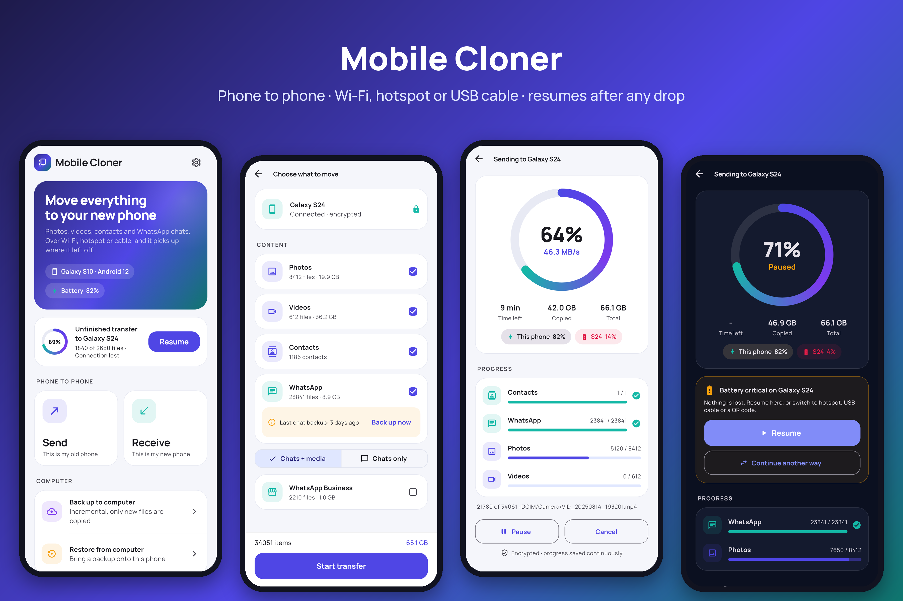
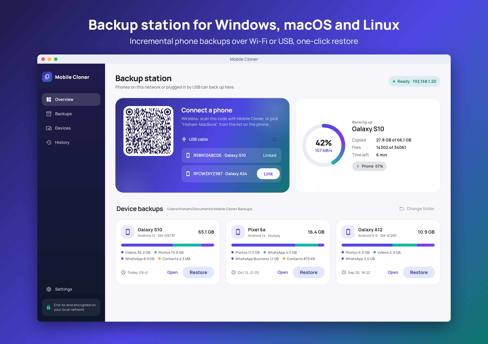

# Mobile Cloner

Move everything from an old Android phone to a new one, and back phones up to a computer.
Photos, videos, contacts and WhatsApp / WhatsApp Business chats move over Wi-Fi, a private
hotspot, or a USB cable, and a transfer survives dropped connections, app restarts and dead
batteries.




## What's in the repo

| Path | What |
|------|------|
| `packages/cloner_core` | Pure Dart: protocol, discovery, encrypted transfer with resume, WhatsApp path mapping, backup store, `cloner` CLI |
| `app` | Flutter app. Android (API 23+, Android 6) for phone-to-phone, Windows / macOS / Linux as the backup station |
| `docs` | Architecture, protocol extension, platform limits |

## Features

- **Phone to phone**: photos and videos at original quality with their folders and capture dates, contacts (system vCard export), WhatsApp and WhatsApp Business.
- **WhatsApp path mapping**: Android 10 and older keep WhatsApp in `/WhatsApp`; Android 11+ in `Android/media/com.whatsapp/WhatsApp`. The receiver writes each file to the location its own Android version uses. Chat databases are sent first.
- **Connections**: same Wi-Fi (multicast discovery), private hotspot made by the receiver (credentials in the QR code), USB cable between phones (Android Open Accessory, like Smart Switch: no tethering or network, HTTP runs through a multiplexed tunnel over the USB bulk endpoints), and computer over USB (ADB port forwarding). Wi-Fi and hotspot modes ask for Android's "Nearby devices" permission ("Location" before Android 13) first. If neither phone can act as USB host, the app suggests the hotspot.
- **Resilience**: byte-level resume, a checkpoint file written atomically after every file, same-device takeover so a transfer can continue on a different connection, battery heartbeat that pauses before a phone dies, foreground service so Android doesn't kill the transfer.
- **Live speed and time left**, measured over a 5 second window.
- **Desktop backup station**: incremental backups (only new files), per-device backup folders with a `backup.json` manifest, one-click restore to a phone.
- **Security**: TLS with self-signed certificates pinned to the fingerprint from discovery or the QR code, optional PIN, path-traversal checks on every incoming file.
- **Compatible with LocalSend** for plain files in both directions.

See [docs/PLATFORM_LIMITS.md](docs/PLATFORM_LIMITS.md) for what Android does not allow (app data, SMS restore rules).

## Build

Flutter is pinned to **3.32.8**: Flutter 3.35+ dropped Android 6 (API 23).

```bash
cd packages/cloner_core && dart pub get && dart test     # core tests
cd app && flutter pub get
flutter build apk --release                              # Android
flutter build windows | macos | linux --release          # backup station
```

### Phone app inside the desktop app

When a phone is plugged in over USB and HK Cloner is missing or older, the desktop app offers to install the APK it ships with. Put the APK there after building both:

```bash
tool/bundle_apk.sh macos       # -> mobile_cloner.app/Contents/Resources/data/hk-cloner.apk (re-signs ad hoc)
tool/bundle_apk.sh linux       # -> build/linux/x64/release/bundle/data/hk-cloner.apk
tool\bundle_apk.ps1            # Windows -> build\windows\x64\runner\Release\data\hk-cloner.apk
```

The desktop app looks in this order: the `HK_CLONER_APK` environment variable, `data/hk-cloner.apk` in its bundle, then `app/build/app/outputs/flutter-apk/app-release.apk` when it runs from a checkout (development). Without an APK, the prompt offers "Choose APK...".

CI (`.github/workflows/build.yml`) runs the core tests, builds all four targets and bundles the APK into each desktop build with the same scripts.

## Command line

```bash
cd packages/cloner_core
dart run bin/cloner.dart receive --dir ~/PhoneBackups          # headless backup station
dart run bin/cloner.dart discover --scan                         # list nearby devices
dart run bin/cloner.dart restore --to 192.168.1.42 --backup "~/PhoneBackups/Galaxy S10 (SM-G973F) D454CD52"
dart run example/fake_phone.dart 127.0.0.1                       # simulate a phone backing up
```

## Screenshots

`app/screenshots/screenshots_test.dart` renders the main screens with sample data:
`flutter test screenshots/screenshots_test.dart --update-goldens`.

## License

Apache License 2.0. See [LICENSE](LICENSE) and [NOTICE](NOTICE).
